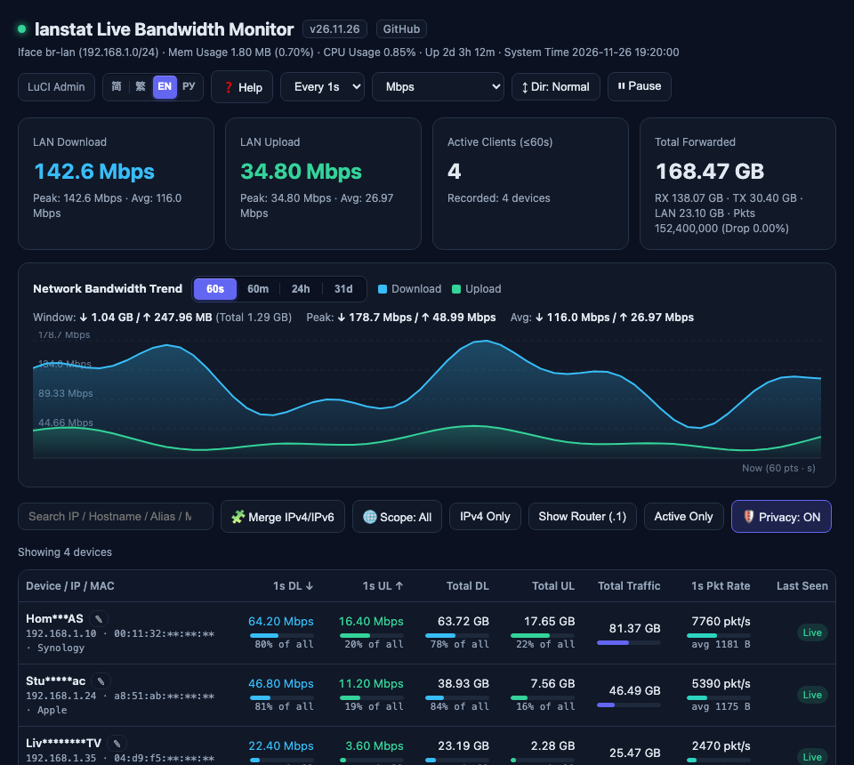

# lanstat

**[English](README.md) | [简体中文](README_ZH.md)**

Lightweight, single-binary native C11 real-time LAN bandwidth monitor for OpenWrt / ImmortalWrt routers.

See **which device is using your bandwidth every second** — with ~1.8 MB RAM usage, zero flash writes, and zero external runtime dependencies.



## Features

- **Ultra-Low Footprint**: Single-threaded C11 binary (~1.8 MB RSS), pure in-memory counters with **zero flash writes** for 24/7 operation.
- **Kernel-Efficient Capture**: `AF_PACKET` + `TPACKET_V2` zero-copy ring buffer + BPF filter (IPv4 / IPv6 / 802.1Q VLAN), with `recv(..., MSG_TRUNC)` fallback.
- **Real-Time Per-Device Dashboard**: Built-in gzip-compressed Web UI on port `6670` with 1s–5s polling, global & per-device trend charts (60s / 60m / 24h / 31d), proportional share bars, and packet rate (`pps` + average packet size).
- **Flexible Views & Sorting**: Filter by **All / WAN-only / LAN-only** traffic, merge IPv4+IPv6 by MAC, IPv4-only / active-only toggles, 6-mode identity sorting (Device / IP / MAC), and hot-switch network interface from the UI.
- **Offline Device Identification**: Reads `/tmp/dhcp.leases`, `/etc/hosts`, and `/etc/ethers` directly (no DNS subprocesses), plus a built-in **21,000+ offline IEEE OUI vendor dictionary** and custom local device notes.
- **Privacy & Multi-Language**: One-click **Privacy Mask** mode for screenshots (search still matches plaintext), built-in 4-language sliding switcher (**简 / 繁 / EN / РУ**) with automatic browser locale detection, and mobile-friendly responsive layout (Safari / Chrome / Edge / iOS / Android).

## Installation

Download the matching package for your router architecture (`uname -m` or `opkg print-architecture` / `apk --print-arch`) from [GitHub Releases](../../releases):

### OpenWrt 25.12+ (`.apk`)

```sh
apk add --allow-untrusted lanstat-*.apk
/etc/init.d/lanstat enable
/etc/init.d/lanstat start
```

### OpenWrt 23.05 / 24.10 (`.ipk`)

```sh
opkg install lanstat_*.ipk
/etc/init.d/lanstat enable
/etc/init.d/lanstat start
```

### Universal Static Tarball (`.tar.gz`)

```sh
mkdir -p /tmp/lanstat-pkg
tar -xzf lanstat-<arch>.tar.gz -C /tmp/lanstat-pkg
sh /tmp/lanstat-pkg/install.sh
```

Then open `http://<router-ip>:6670/` in your browser.

## Configuration (`/etc/config/lanstat`)

```uci
config lanstat 'main'
	option enabled '1'
	option interface 'br-lan'
	option bind '0.0.0.0'
	option port '6670'
	option promisc '1'
	option track_external '0'
	option max_hosts '512'
	option ring_kb '1024'
```

- `interface`: Logical OpenWrt interface (e.g. `lan`) or Linux device name (e.g. `br-lan`).
- `bind`: HTTP listen IP (default `0.0.0.0`; set to your router's LAN IP e.g. `192.168.1.1` if you want to restrict binding to LAN only).
- `port`: Web dashboard port (default `6670`).
- `promisc`: Enable promiscuous capture mode (`1` recommended on bridge interfaces).
- `track_external`: Also record external/WAN peers (`0` keeps table focused on LAN devices).
- `max_hosts`: Pre-allocated host table capacity (default `512`).
- `ring_kb`: `TPACKET_V2` RX ring buffer size in KiB (default `1024`).

Apply changes with `/etc/init.d/lanstat reload`.

## Security & Firewall Notes

- By default OpenWrt blocks unsolicited inbound connections from the `wan` zone, so port `6670` is only reachable from `lan`.
- If you run `lanstat` on a single-arm router, bypass gateway, or host with permissive firewall rules, set `option bind '<lan-ip>'` in `/etc/config/lanstat` (or add a firewall rule) so the dashboard and `POST /api/iface` endpoint are not exposed to untrusted networks.

## Hardware Offloading Caveats

Packet capture via `AF_PACKET` observes packets processed by the Linux kernel network stack:

- **HWNAT / SFE / Software & Hardware Flow Offloading**: Established NAT flows offloaded to hardware/fast-path bypass the kernel bridge; `lanstat` still sees connection setup and non-offloaded traffic, but sustained throughput on offloaded wired flows may appear significantly lower than actual speed (typically 60%–95% undercounted depending on driver/SoC).
- **MediaTek WED (Wireless Ethernet Dispatch)**: If WED is enabled on MT798x devices, offloaded Wi-Fi flows may also bypass kernel capture. Disabling flow offloading / WED restores 100% accurate accounting at the cost of higher CPU usage at gigabit speeds.

## Build & Test (Host + Multi-Arch)

```sh
# Run JS syntax check, host ASan+UBSan tests, and build default aarch64 package
make clean all

# Cross-compile & verify all 5 target architectures (-Werror)
make check-arches

# Build a specific static architecture tarball (x86_64, aarch64, armv7, mipsel, mips)
make package ARCH=x86_64
```

## OpenWrt SDK Package Build (`.ipk` / `.apk`)

Copy `openwrt-package/lanstat` into your OpenWrt SDK under `package/lanstat` and run:

```sh
make defconfig
make package/lanstat/compile LANSTAT_LOCAL_SRC=/path/to/lanstat V=s
```

### Submitting to `openwrt/packages` or `immortalwrt/packages`

1. Tag a release (e.g. `v1.0.0`) on GitHub so the source tarball URL is immutable.
2. Update `PKG_SOURCE_URL`, `PKG_HASH`, `PKG_MAINTAINER`, and `URL` in `openwrt-package/lanstat/Makefile`.
3. Submit `openwrt-package/lanstat/` as `net/lanstat/` via PR to `openwrt/packages` or `immortalwrt/packages`.

## Data Attribution & License

- Source code is licensed under the [MIT License](LICENSE).
- The compact offline vendor table in `web/oui_packed.txt` is derived from the public IEEE Standards Association OUI registry.
